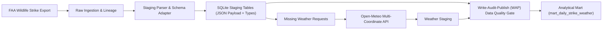

# Architecture

## Target Flow

## Architectural Principles

1. **Zero-Dependency Core:** Implemented strictly with the Python 3.10+ Standard Library (`sqlite3`, `urllib`, `csv`, `hashlib`, `dataclasses`, `unittest`, `logging`). Guarantees zero supply-chain vulnerabilities, zero package conflicts, and instant startup times in any container or CI runner.
2. **Schema-on-Write with Raw Audit Fallback:** Staging tables extract typed business fields (`incident_date`, `airport_code`, `damage_level`) while retaining the full unaltered raw line in `raw_payload` (JSON) and generating a deterministic SHA-256 surrogate key (`_stable_id`). If source schema evolves or new dimensions are needed, historical data can be re-parsed without re-downloading source files.
3. **Write-Audit-Publish (WAP) Pattern:** Analytical marts are not populated unconditionally. In the Airflow DAG (`weather >> dq >> mart`), data quality assertions (`dq.py`) act as a circuit breaker. If null invariants, grain uniqueness, or weather coverage checks fail, the pipeline halts with exit code 1, preventing corrupted data from reaching the mart.

## Layers

| Layer | Target Table / Object | Purpose |
|---|---|---|
| `raw` | `raw_strike_files` | Audit trail of processed filenames, source URLs, and ingestion timestamps. |
| `staging` | `staging_strikes` | Normalized schema with alias mapping (`FIELD_ALIASES`), typed attributes, and raw JSON fallback. |
| `reference` | `dim_airport` | Airport geocoordinates (lat/lon) and metadata required for spatial weather enrichment. |
| `weather` | `weather_daily` | Historical weather observations fetched via batched API or pre-staged CSV. |
| `mart` | `mart_daily_strike_weather` | Clean analytical view joining wildlife incidents with weather metrics, grouped strictly by date and airport grain. |

## Current Offline MVP

The deterministic local flow uses three small fixtures:

- `data/raw/sample_wildlife_strikes.csv`
- `data/raw/sample_airports.csv`
- `data/raw/sample_weather_daily.csv`

Expected mart rows after the sample load:

| incident_date | airport_code | strike_count | strikes_with_damage_level | temperature_2m_mean | precipitation_sum |
|---|---:|---:|---:|---:|---:|
| 2023-08-01 | JFK | 2 | 1 | 25.4 | 0.0 |
| 2023-08-02 | LGA | 1 | 0 | 24.8 | 2.1 |

The default offline checks verify staging row presence, required event fields, weather uniqueness, complete sample weather coverage, and mart grain uniqueness.

## Design Trade-offs & Known Limitations

- **Date-Range Batching Granularity:** Weather enrichment groups API requests by `(min_date, max_date)` per airport. For multi-decade historical FAA dumps with sparse events, a date-window chunking strategy (e.g. annual or monthly partition buckets) is recommended to avoid retrieving unused days.
- **Relational Storage:** SQLite is selected for zero-infrastructure demonstration and local portability. All DDL and SQL views adhere to ANSI SQL standards to enable straightforward migration to PostgreSQL or DuckDB.
