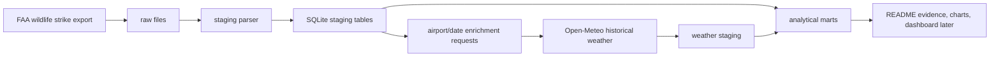

# Architecture

## Target Flow

## Layers

| Layer | Purpose |
|---|---|
| `raw` | Store original downloaded files without mutation. |
| `staging` | Normalize column names, types, and source-specific quirks. |
| `core` | Stable event, airport, species, and weather entities. |
| `mart` | Small analytical tables for DA/DS users and portfolio evidence. |

## Current Offline MVP

The deterministic local flow uses three small fixtures:

- `data/raw/sample_wildlife_strikes.csv`
- `data/raw/sample_airports.csv`
- `data/raw/sample_weather_daily.csv`

Expected mart rows after the sample load:

| incident_date | airport_code | strike_count | temperature_2m_mean | precipitation_sum |
|---|---:|---:|---:|---:|
| 2023-08-01 | JFK | 2 | 25.4 | 0.0 |
| 2023-08-02 | LGA | 1 | 24.8 | 2.1 |

The default offline checks verify staging row presence, required event fields, weather uniqueness, complete sample weather coverage, and mart grain uniqueness.

## Open Questions

- What FAA export format is easiest to automate today: CSV, Access database, or browser export?
- Does FAA provide reliable airport coordinates in the export, or do we need a separate airport reference table?
- Should enrichment use event date only or event date plus local hour when time is available?
- Which public sample can be committed safely without redistributing a large source export?
